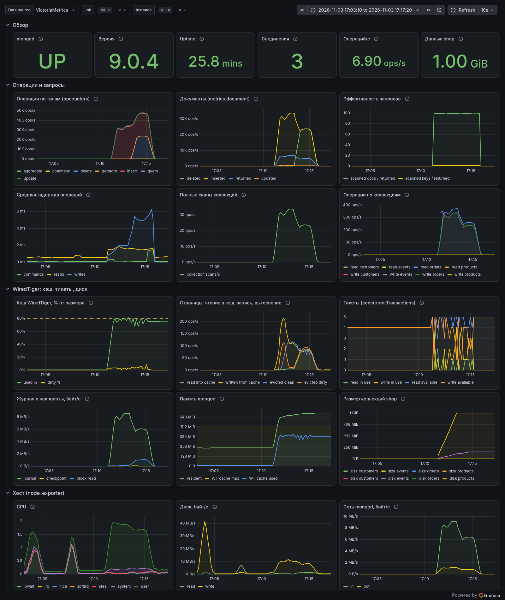
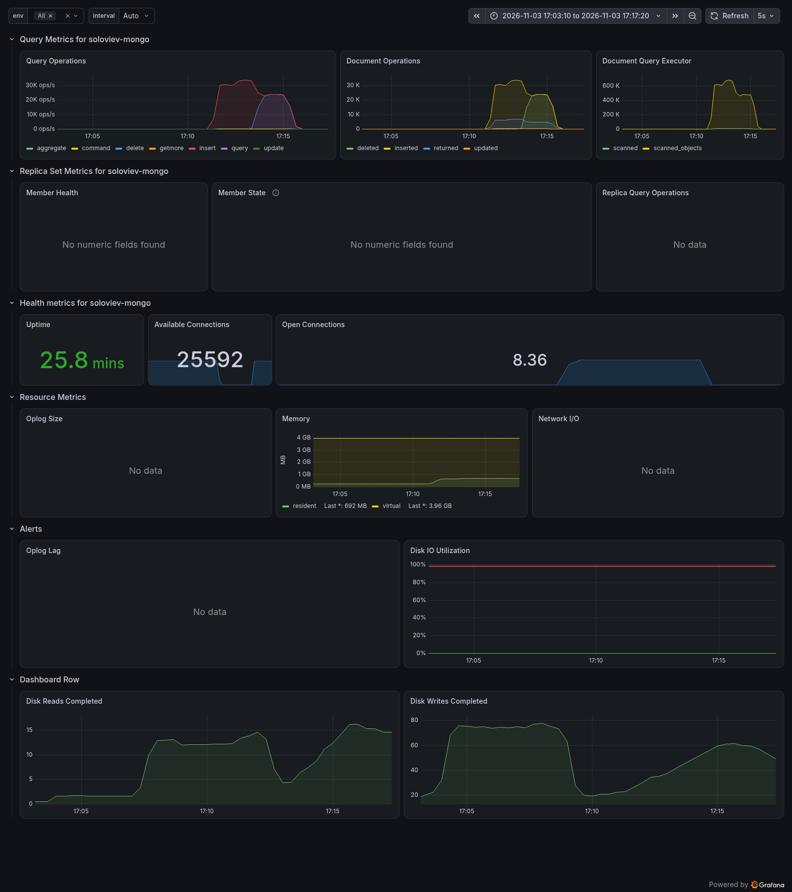
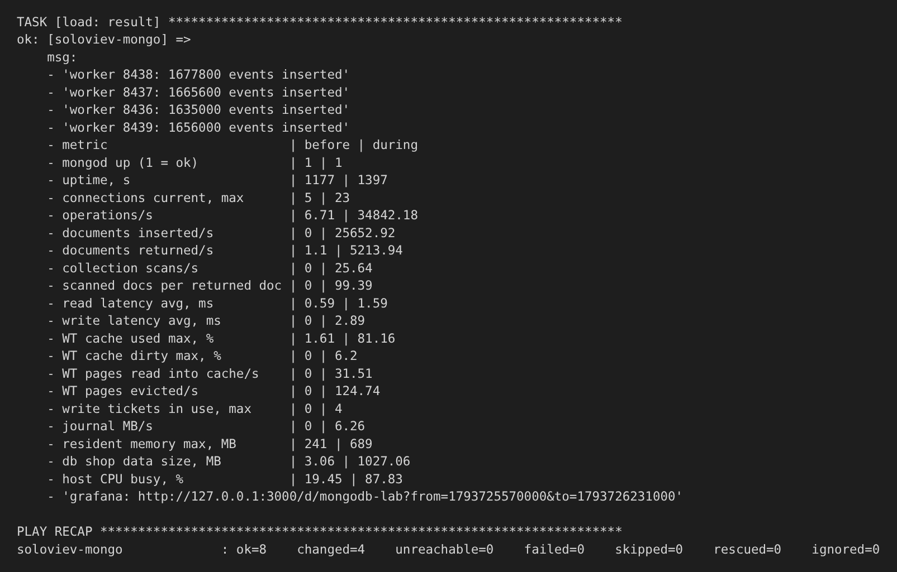

# ЛР-1. Эксплуатация MongoDB

Как запускается:

```
macOS (Ansible) --ssh--> ВМ Ubuntu 24.04 arm64 (Vagrant + VMware Fusion)
                           mongod :27017
                           mongodb_exporter :9216 --+
                           node_exporter    :9100 --+--> VictoriaMetrics :8428 <-- Grafana :3000
```

Из неприятного: у Mongodb есть deb пакеты в Debian только под amd64, поэтому на маке без эмуляции не запустить, в итоге взял Ubuntu 24.04

Через vagrant поднял виртуалку, дальше через ansible накатывал монгу

```bash
vagrant up
ansible-playbook site.yml
```

Также это все добро запускается в github actions.

Почитал гайд по сетапу монги в проде, узнал про Transparent Huge Pages и то, что их стоит включать, когда используется TCMalloc.

https://www.mongodb.com/docs/manual/administration/tcmalloc-performance/#enable-transparent-hugepages-thp

Еще круто, что в монге можно напрямую через js делать запросы. Удобно генерировать данные, писать условия/обработку исключений.

Про доступы - дефолтные read/readWrite распространяются на всю бд, поэтому для доступов к одной коллеции нужно было создать отдельную роль.

Для бекапов результат mongodump кладется в директорию с timestamp, старые бекапы не перезаписываются (mkdir падает когда директория существует).

Для мониторинга взял victoriametrics single node - один бинарник для приема, хранения и отдачи метрик.

Экспортер взял [percona/mongodb_exporter](https://github.com/percona/mongodb_exporter) - крутые ребята, у них много инструментов для работы с субд есть. + node_exporter для метрик cpu/mem.

С deb пакетами из apt.grafana.com проблемки 403. Поэтому ставил deb с dl.grafana.com/oss/release/.

Взял 2 дешборда - один навайбил, второй импортировал из маркетплейса графаны.



Тот же интервал на готовом дашборде 12079:



Вывод таски `load`: [docs/load-result.txt](docs/load-result.txt).

`load` запускает 4 процесса mongosh со скриптом `files/load.js` на 180 с. Каждый в цикле вставляет пачки по 100 документов в `shop.events`, читает заказы по индексу, иногда ищет по полю без индекса и обновляет статус заказа.

Еще замеры:

```
metric                        | before | during
operations/s                  | 6.7 | 21883.85
documents inserted/s          | 0 | 21425.02
documents returned/s          | 1.1 | 4354.4
collection scans/s            | 0 | 21.38
scanned docs per returned doc | 0 | 99.25
read latency avg, ms          | 0.61 | 1.3
write latency avg, ms         | 0 | 3.01
WT cache used max, %          | 1.6 | 77.29
WT cache dirty max, %         | 0 | 4.96
WT pages read into cache/s    | 0 | 0.82
WT pages evicted/s            | 0 | 5.65
write tickets in use, max     | 0 | 2
journal MB/s                  | 0 | 5.23
resident memory max, MB       | 248 | 673
db shop data size, MB         | 3.06 | 326.36
host CPU busy, %              | 39.47 | 59.49
```

Что видно на графиках:

- Кэш WiredTiger специально сделал маленьким `cacheSizeGB: 0.5`. За минуту нагрузки он дошёл до 77%. При пороге 80% видно вытеснение страниц на диск.
- scanned / returned ~99: `find({total: ...})` без индекса, он читает все 20000 заказов.
- write tickets заняты максимум 2, то есть очереди к движку не было, упирались в CPU ВМ.

Таблица `load: result` того же прогона на 240 с, что и скриншоты дашбордов:


