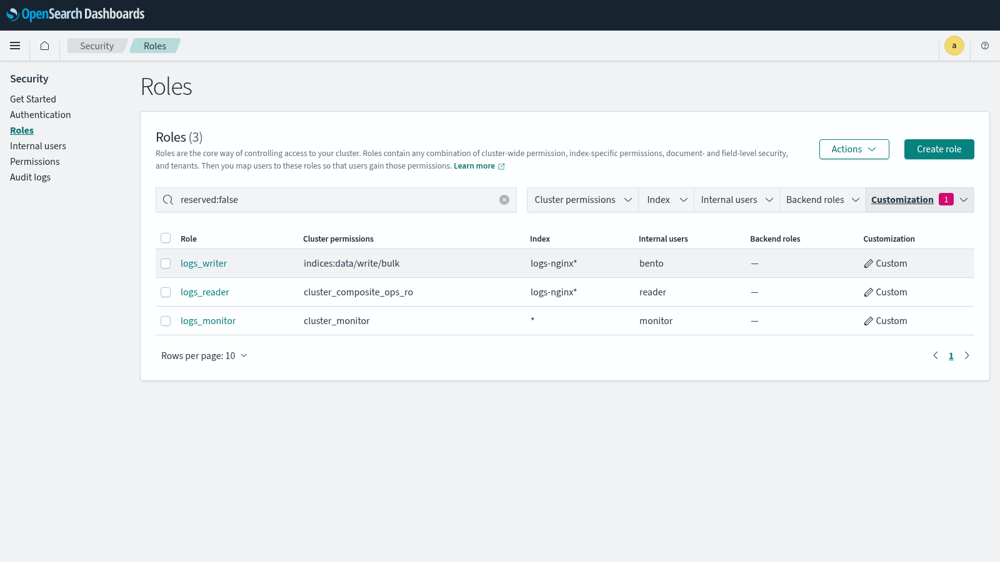
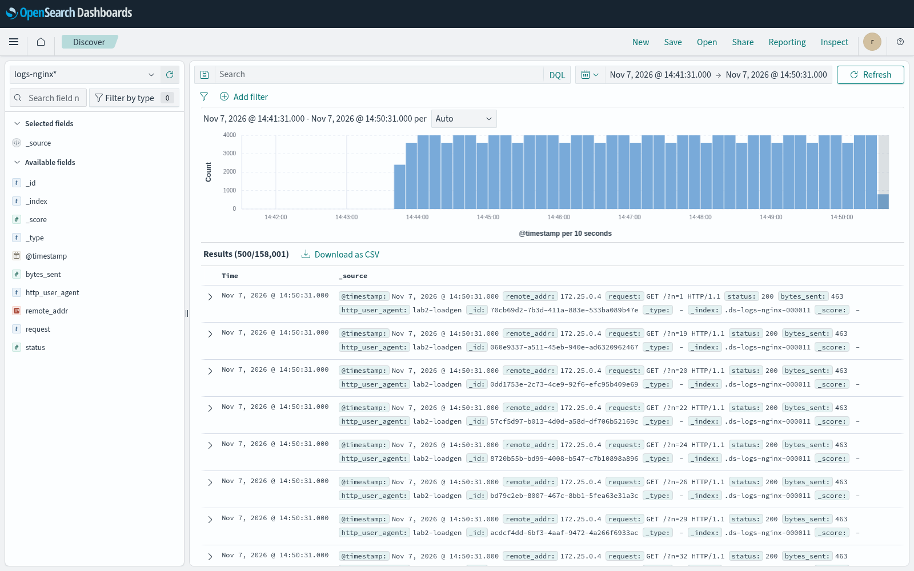
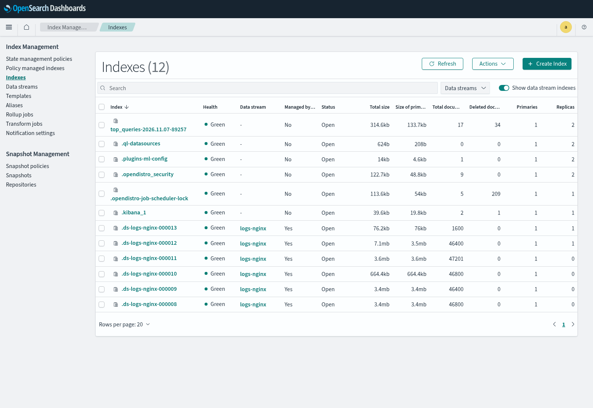
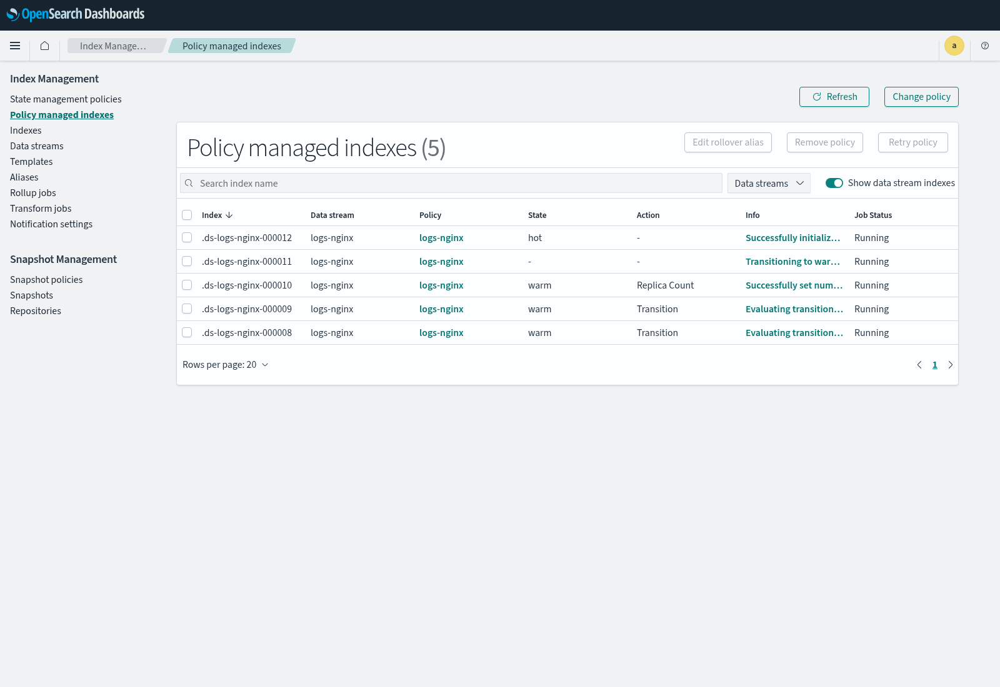
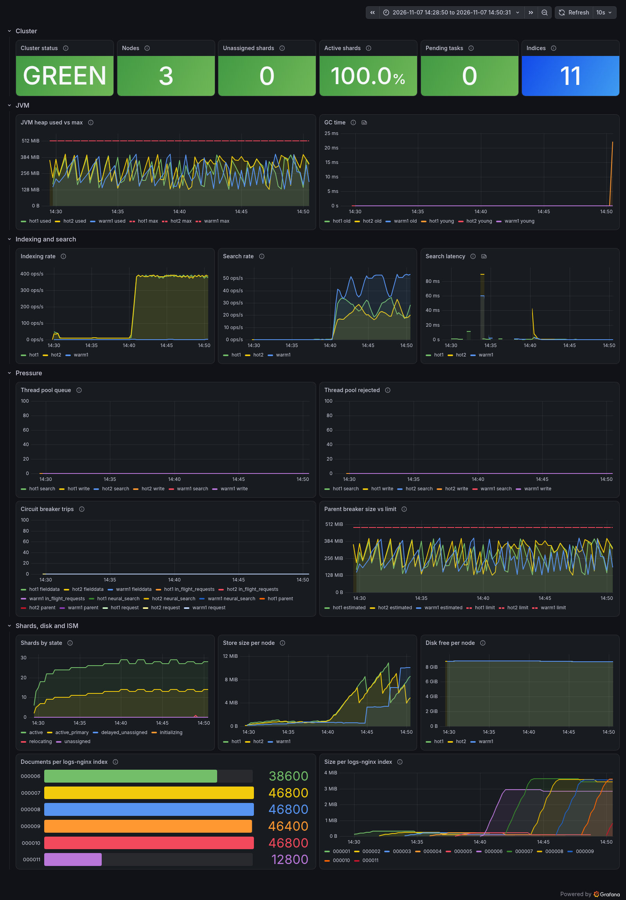
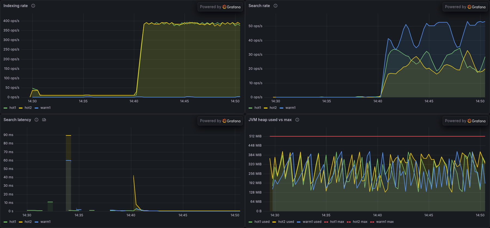

# ЛР-2. Эксплуатация OpenSearch

Собрал hot-warm кластер в docker compose - два hot узла и один warm. TLS включен и на transport, и на REST

Версия 3.9.0, в задании 3.8.

```
loadgen -> nginx :8080 -> JSON access log -> Bento -> logs-nginx
                                                   hot1 + hot2 -> warm1 -> delete
Dashboards :5601 -> OpenSearch :9200
Prometheus :9090 -> плагин на каждом узле -> Grafana :3000
```

Запуск:

```bash
cp .env.example .env
docker compose up -d --build
```

Минут через 15 успевают пройти и rollover, и удаление старых индексов.

Dashboards на http://localhost:5601 - `reader` / `ReaderLab2pass!`

Grafana на http://localhost:3000 - `admin` / `GrafanaLab2pass!`

На Linux нужен `vm.max_map_count >= 262144`, иначе OpenSearch не стартует.

Сертификаты генерит openssl в одноразовом контейнере certs.

Про доступы - Bento ходит по клиентскому сертификату и умеет только писать в `logs-nginx*`. reader читает логи и заходит в Dashboards, monitor видит метрики, но документы читать не может



Паттерн взял `logs-nginx*`, а не `logs*` как в задании, потому что поток тут один.

Логи: nginx пишет JSON в общий volume, Bento отправляет их в data stream `logs-nginx`. Шаблон задает типы полей и кладет новые индексы на hot.

Политика ISM делает rollover при 1 МБ или через минуту, потом переносит индекс на warm и удаляет через 10 минут. На warm одна нода, поэтому перед переносом убираю реплику, иначе кластер желтеет.

Из неприятного: ISM проверяет условия по расписанию, это не точный таймер. Интервал уменьшил до минуты, но rollover все равно получался примерно раз в 2 минуты и индексы успевали вырасти до 3.5 МБ







Для мониторинга поставил плагин Prometheus от Aiven прямо в образ OpenSearch. На дашборде здоровье кластера, heap и GC, скорость индексации и поиска, очереди, шарды и диск.

Обычная нагрузка:



Потом включил `BATCH=200` и 10 поисковых запросов в секунду. Индексация на hot узлах дошла примерно до 380 документов/с


