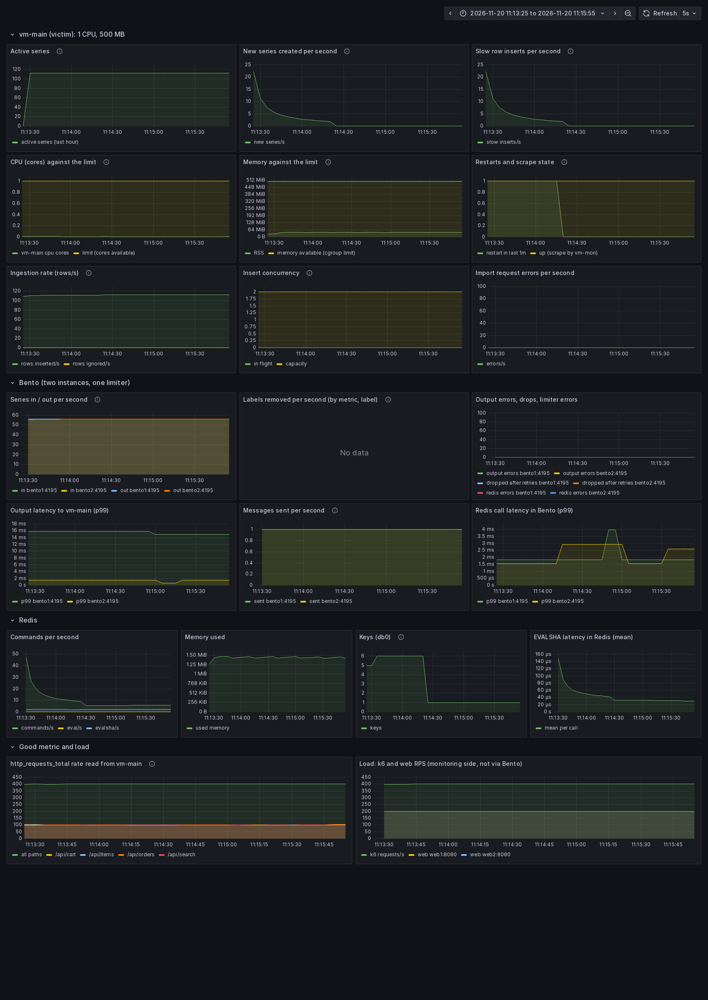
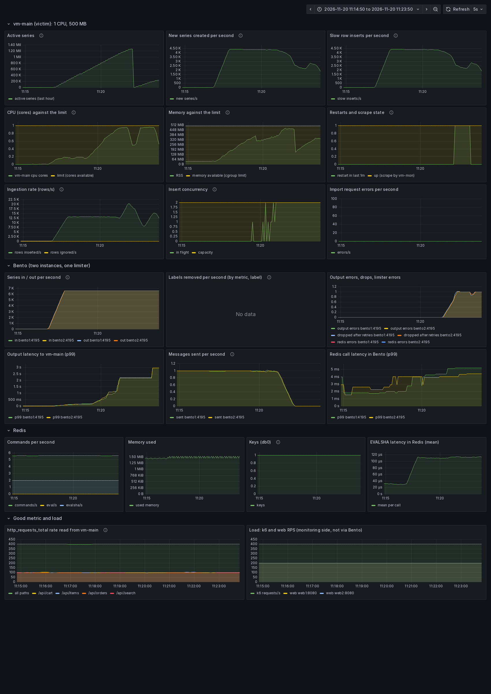
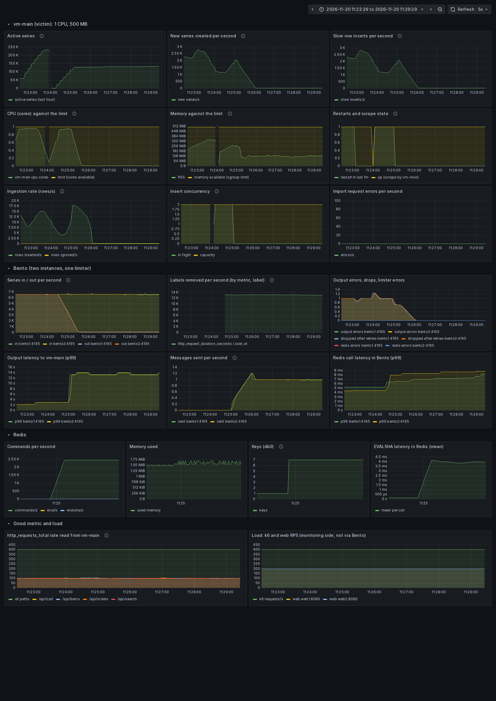
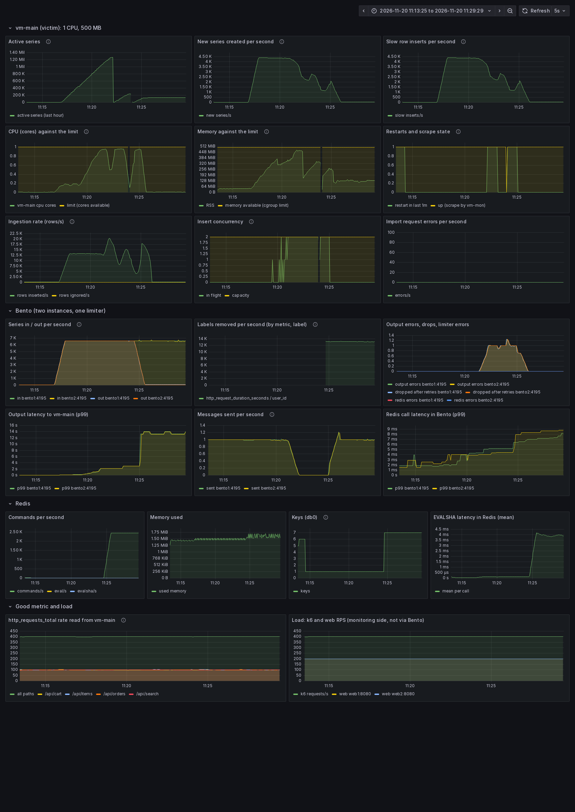

# ЛР-3. Redis как общий счетчик для лимитера кардинальности

Часто сталкивался с проблемой: есть продовый стек доставки метрик, какой-то сервис начинает экспортировать высококардинальные метрики, и это прикладывает VictoriaMetrics.

Нужно решение, которое работает как лимитер кардинальности.

```
k6 400 rps --> web1, web2 /metrics
                 ^ scrape раз в секунду
               bento1, bento2 (stream processor) --inc counter--> redis
                 |
                 v
               VictoriaMetrics <-- grafana
```

Есть очень интересный проект - https://github.com/warpstreamlabs/bento
Под него можно писать кастомные процессоры на JS. И у него есть коннектор к Redis, запросы к Redis пишутся на Lua.

Идея в том, чтобы для каждого лейбла считать сколько раз встретилось его значение и сохранять счетчик в редисе.

Реплик bento несколько, они горизонтально масштабируются, нужно одно общее хранилище счетчика кардинальности, поэтому поднимаем общий редис.

И сама метрика остается, отсекаем только растущий высококардинальный лейбл. Lua лежит в `bento/bento.yaml`.

Подход - fail-open, когда редис лежит - пропускаем все.

Готового парсера prometheus формата в Bento нет, поэтому парсим регулярками через js (надеюсь я найду решение лучше). Еще я слышал, что под Bento можно Go плагины писать.

Запуск:

```bash
docker compose up -d --build
```

Grafana на http://127.0.0.1:3000

Включить user_id (высококардинальный лейбл) в гистограмме:

```bash
curl -X POST 'http://127.0.0.1:8081/flags?user_id=on'
curl -X POST 'http://127.0.0.1:8082/flags?user_id=on'
```

Лимитер: 0 выключен, 1 включен:

```bash
docker compose exec redis redis-cli SET limiter:enabled 0
```

Нагрузка все время одна и та же, k6 400 rps.

Фаза 1, 11:13-11:17. Обычные метрики, 112 серий.



Фаза 2, 11:17-11:24. Включил user_id. Запросов столько же, а серий выросло до 1.27M.

CPU vm-main упирается в лимит, память 492 из 500 MB, около 11:22 рестарт. Bento перестает отправлять, растут ошибки отправки.



Фаза 3, 11:24-11:29. Включил лимитер. Для чего все и затевалось

Серий 133k и больше не растет, новых серий 0. В Redis у user_id ровно 100 значений (в целом, можно и меньше лимит было поставить)

При этом другие метрики по типу http_requests_total не теряются, все так же 400/s, как в фазе 1



Весь прогон целиком:


